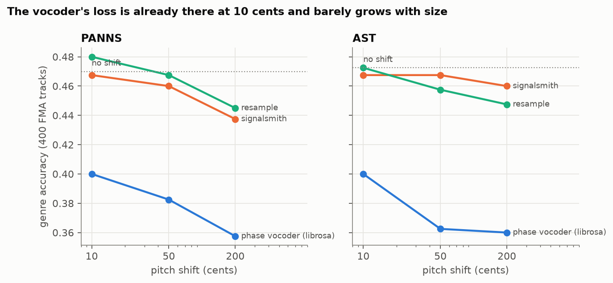
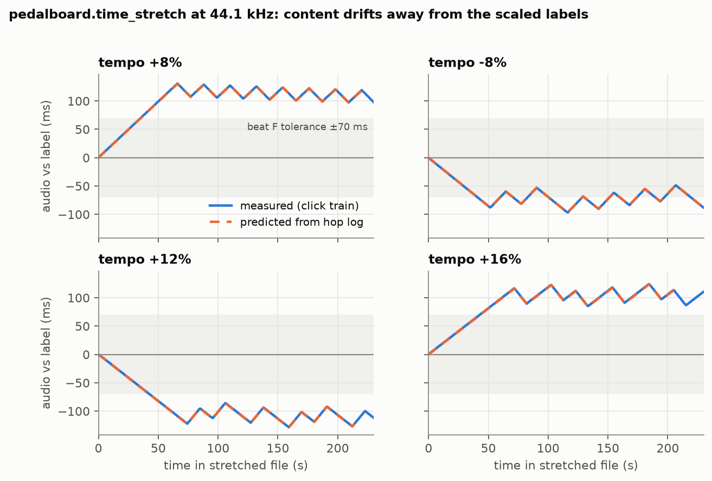

# tsm-confound

[](https://github.com/Juhani1104/tsm-confound/actions/workflows/ci.yml)
[](https://www.python.org/)
[](https://pytorch.org/)
[](#tools-compared)
[](#results)
[](LICENSE)
[](experiments/00-setup.md)
[](https://github.com/astral-sh/ruff)
[](https://github.com/Juhani1104/tsm-confound/commits/main)

**Pitch and tempo robustness tests often measure the audio tool, not the model.**

To test whether a music model copes with a change in pitch or tempo, people shift the
audio with a time-scale modification (TSM) tool and see how much the score drops. This
repository makes the same change with six tools, on six tasks and seven models, and
checks how much of the drop comes from the change itself and how much from the tool.

<p align="center">
  
</p>

<sub>Genre-probe accuracy on 400 FMA tracks. The phase vocoder's loss is already there at
10 cents and barely grows with the shift; the other tools lose 1–4 points even at 200
cents.</sub>

- **The tool, not the change.** On NSynth, a real recording two semitones higher leaves
  probe accuracy unchanged, while phase vocoders and Rubber Band lose 4–8 points on the
  same shift. A published piano-transcription result (Edwards et al. 2024) reproduces
  only with a phase vocoder.
- **A timing bug in Rubber Band R3.** Fed large blocks (still within the API's limit),
  the R3 engine lets its output drift by up to 3 ms per second: 159 ms after 55 s at
  +50 cents. It shows in Rubber Band 3.3.0 and 4.0.0, and `pedalboard.time_stretch`
  triggers it by default.
- **The bug is in public training data.** Beat This!'s released tempo-augmented
  spectrograms put 70–85% of beats more than 70 ms off their labels on long tracks.
  Models retrained on them track beats worse than models trained with no tempo
  augmentation at all.

## Tools compared

Every nominal change is made with each tool, using the same direction per piece, so the
tools can be compared piece by piece (`src/transforms.py`).

| Tool | Method | Common in |
|---|---|---|
| `librosa` | phase vocoder, n_fft 2048 | audiomentations before 0.39 |
| `torchaudio` | phase vocoder, n_fft 512 (pitch), 2048 (tempo) | torchaudio built-ins |
| `signalsmith` | signalsmith-stretch | audiomentations 0.39 and later |
| `rubberband` | `pedalboard.time_stretch`, default settings | Beat This!'s tempo augmentation |
| `rbsmall` | the same engine and options, 4096 samples per call | the fix found here |
| `resample` | pitch and tempo change together, no stretching | reference (labels rescaled) |

## Results

Each experiment has a short page in [`experiments/`](experiments) that says what it
asks, how to run it and which files it writes. Figures are drawn from the result files
by `src/make_figures.py`.

| Experiment | Headline | Evidence |
|---|---|---|
| Published piano result (Kong, ±10 cents) | phase vocoder −11.39 / −17.41 onset F1 on MAESTRO / Studio MAESTRO, against −11.6 / −19.2 published; signalsmith and resampling lose under 2 | [`replicate.txt`](results/replicate.txt) |
| Real vs simulated pitch (NSynth, 400 pairs) | the real recording 2 semitones up: no change; the tools: −0.6 to −7.7 points | [`summary_truevar.txt`](results/summary_truevar.txt) |
| Genre probe (FMA, PANNs and AST) | phase vocoder loses ~7 points at 10 cents, and only 4 more by 200 cents | [`timbre2.txt`](results/timbre2.txt) |
| AI-music detection (Deezer, 80 tracks) | ±10 cents: only the phase vocoders lower AUC (0.986 → 0.93); ±200 cents: every stretching tool does, resampling stays at 0.98 | [`summary_aidetect.txt`](results/summary_aidetect.txt) |
| Piano transcription under pedalboard (Kong, 30 pieces) | ±10 cents drops onset F1 from 0.965 to 0.391; one straight-line time map brings it back to 0.951 | [`summary_piano_all_rescore.txt`](results/summary_piano_all_rescore.txt) |
| Rubber Band drift mechanism | the engine's own hop log predicts the measured drift to 0.2–1.2 ms RMS at all ten tempo factors | [`rb_mechanism.txt`](results/rb_mechanism.txt), [`rb4_check.txt`](results/rb4_check.txt) |
| Beat This!'s released spectrograms | at −12, +8, +12 and +16% tempo, 81–85% (Candombe) and 70–77% (Beatles) of beats are more than 70 ms off | [`bt_spect_check_candombe.txt`](results/bt_spect_check_candombe.txt), [`_beatles.txt`](results/bt_spect_check_beatles.txt) |
| Beat This! retraining (4 sets × 5 seeds, 11 sets × 3 seeds) | drifted labels give the lowest beat F (70 ms) on both test sets at both scales; corrected labels +0.010 on GTZAN (5/5 seeds) | [`summary_bt*.txt`](results/summary_bt.txt) |
| Phase-vocoder timing | with phase locking, the spread of onset shifts falls from 6.4–16.3 ms to 1.0–1.7 ms (2048 window) | [`vocoder_phase.txt`](results/vocoder_phase.txt) |

<p align="center">
  
</p>

<sub>`pedalboard.time_stretch` at 44.1 kHz: the stretched audio drifts away from the
scaled labels. The dashed line is predicted from the engine's own hop log.</sub>

**Recommendations.** Use at least two tools built on different principles (for example
signalsmith and resampling) and report their names and versions. Suspect the tool when
the loss appears at the smallest shift and does not grow. With Rubber Band R3, pass at
most 4096 samples per `process()` call; data already made with pedalboard's defaults can
have its labels corrected with `src/bt_lagcurves.py`.

## Reproducing

Setup, packages, datasets and model weights are listed in
[`experiments/00-setup.md`](experiments/00-setup.md). Data goes in `data/` and weights in
`ext/` (or set `TSM_DATA` and `TSM_EXT`).

| Level | Command | Needs |
|---|---|---|
| Redraw the figures | `sh run/13_figures.sh` | this repo |
| Rerun one experiment | `sh run/NN_<name>.sh` | its data and weights, a CUDA GPU (8 GB) |
| Retrain Beat This! | `sh run/12_beat_this_training.sh` | about a day on one GPU |

<details>
<summary>Experiment → page → script</summary>

| Experiment | Page | Script |
|---|---|---|
| Checking the tools themselves | `experiments/01-tools.md` | `run/01_tools.sh` |
| Genre and beats on real songs (FMA) | `experiments/02-fma.md` | `run/02_fma.sh` |
| Re-running a published robustness test | `experiments/03-replicate.md` | `run/03_replicate.sh` |
| Piano transcription under every tool | `experiments/04-piano.md` | `run/04_piano.sh` |
| Guitar notes and beats | `experiments/05-guitar.md` | `run/05_guitar.sh` |
| Instrument family on single notes (NSynth) | `experiments/06-nsynth.md` | `run/06_nsynth.sh` |
| A real pitch change versus a simulated one | `experiments/07-real-pitch.md` | `run/07_real_pitch.sh` |
| AI-music detection | `experiments/08-ai-detection.md` | `run/08_ai_detection.sh` |
| The Rubber Band time drift | `experiments/09-rubberband-drift.md` | `run/09_rubberband.sh` |
| Why phase-vocoder output sounds early | `experiments/10-vocoder-timing.md` | `run/10_vocoder.sh` |
| Checking Beat This!'s released training data | `experiments/11-beat-this-data.md` | `run/11_beat_this_data.sh` |
| Does the drift hurt a trained model? | `experiments/12-beat-this-training.md` | `run/12_beat_this_training.sh` |
| Figures | | `run/13_figures.sh` |

</details>

## Repository layout

```
src/           tools, task scripts and analysis (paths in src/paths.py)
run/           one shell script per experiment
experiments/   one page per experiment: what it asks, how to run it, output files
results/       result files and summaries (large logits and logs are not in git)
docs/          figures
index/         which MAESTRO pieces were used, and Studio MAESTRO offsets
```

## Limitations

- Small scale per task (30 piano pieces, 60 guitar clips, 400 genre tracks), and one or
  two models per task.
- Retraining used a small Beat This! (2.1M parameters) on up to 11 of its 16 datasets;
  the effect on the full model is unknown. Effects are 1–3 points.
- The real-pitch control covers only 200 cents on 4-second single notes.
- The retraining gain holds at the usual 70 ms beat tolerance; at a strict 20 ms, the
  corrected labels no longer beat the drifted ones on the 11-dataset runs.
- Not yet confirmed with the Rubber Band or Beat This! authors.

## Related

The piano experiments grew out of
[piano-tuning](https://github.com/Juhani1104/piano-tuning), which measures how real
tuning offsets affect piano transcription and corrects them before inference.

## License

Code and result files: MIT. See [LICENSE](LICENSE). The datasets keep their own
licenses (MAESTRO and Studio MAESTRO: CC BY-NC-SA 4.0; FMA: per-track Creative
Commons), and no audio is redistributed here.
